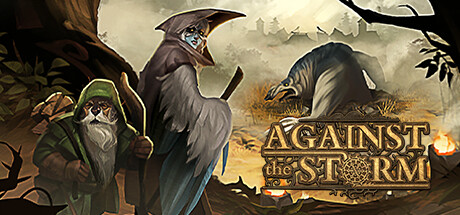

**Against the Storm is a roguelite city-builder by Eremite Games (2023).**

---

## 📖 About

Against the Storm is a roguelite city-builder by Eremite Games (2023). You are the Queen's Viceroy, tasked with rebuilding civilization in a rainy, ever-hostile wilderness. Each settlement run is a 40-minute race against corruption, rain cycles, and resource scarcity. Winning unlocks meta-progression but losing punishes severely.

## ⚠️ Problems Without Trainer

| Problem | Status |
|---------|--------|
| Villager needs escalate faster than production chains can satisfy | ✅ Solved |
| Hostile rain cycles destroy buildings before you can upgrade defenses | ✅ Solved |
| Meta-progression cornerstones feel locked behind excessive grind | ✅ Solved |
| Resolve meter crashes when multiple species have conflicting needs | ✅ Solved |
| Wood and stone shortages halt expansion at critical build windows | ✅ Solved |

## ✅ Solution

The **Against the Storm Trainer** solves all these issues, giving you complete control so you can focus on enjoying the game.

## 🎯 Features

- Unlimited Resources / Currency
- God Mode / Invincibility
- Instant Skill & Ability Cooldown
- One-Hit Kill
- Freeze Timers
- Unlock All Items & Achievements
- Custom Speed Multiplier
- Infinite Stamina / Energy

## 🚀 Quick Start

1. **Disable Windows Defender** temporarily (trainer may trigger false positive)
2. Get the trainer from the button above
3. Launch Against the Storm
4. Run the trainer as Administrator
5. Use the hotkeys to activate cheats in-game

## 💎 Free vs Pro

| Feature | Free | Pro |
|---------|------|-----|
| God Mode | ✅ | ✅ |
| Unlimited Resources | ✅ | ✅ |
| Advanced Cheats | ❌ | ✅ |
| Auto-Updates | ❌ | ✅ |
| Priority Support | ❌ | ✅ |

## 💻 Requirements

- Windows 10 / 11 (64-bit)
- Against the Storm (any version)
- .NET Framework 4.8+
- DirectX 11+

## 🍎 macOS

## ⚖️ Legal

Educational and single-player use only.

---

